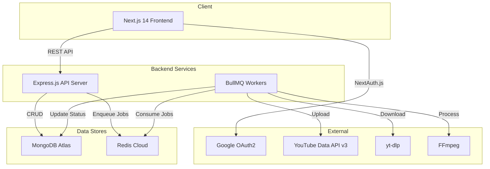
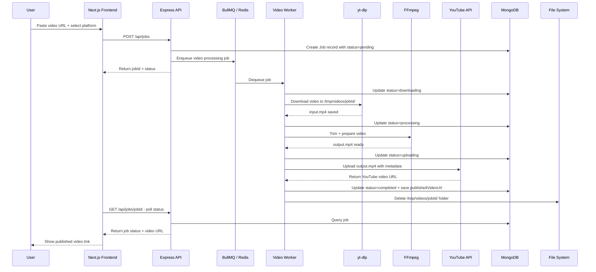
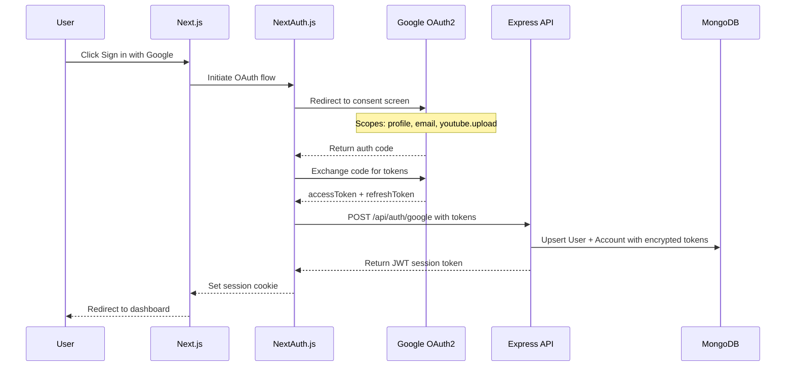
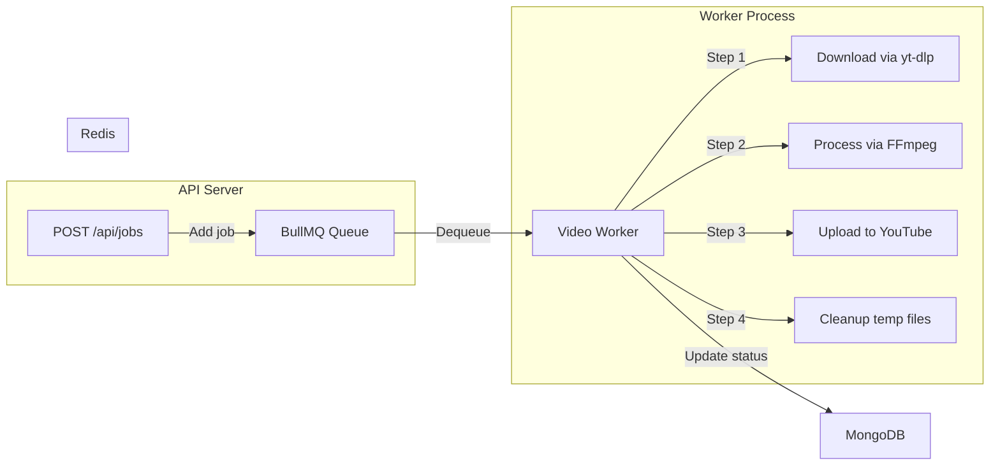
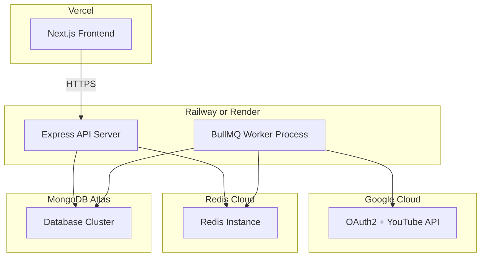

# RePublish SaaS â Architecture Plan

## 1. Overview

A production-ready SaaS web application that allows users to republish short videos from TikTok, Instagram, and Facebook to YouTube. The system handles video downloading, processing, and publishing via a background job queue.

---

## 2. System Architecture



---

## 3. Project Structure

```
sas/
├── frontend/                    # Next.js 14 App Router
│   ├── src/
│   │   ├── app/
│   │   │   ├── layout.tsx
│   │   │   ├── page.tsx
│   │   │   ├── globals.css
│   │   │   ├── api/
│   │   │   │   └── auth/
│   │   │   │       └── [...nextauth]/
│   │   │   │           └── route.ts
│   │   │   ├── dashboard/
│   │   │   │   ├── page.tsx
│   │   │   │   ├── jobs/
│   │   │   │   │   └── page.tsx
│   │   │   │   ├── accounts/
│   │   │   │   │   └── page.tsx
│   │   │   │   └── publish/
│   │   │   │       └── page.tsx
│   │   │   └── auth/
│   │   │       ├── signin/
│   │   │       │   └── page.tsx
│   │   │       └── error/
│   │   │           └── page.tsx
│   │   ├── components/
│   │   │   ├── ui/
│   │   │   │   ├── Button.tsx
│   │   │   │   ├── Input.tsx
│   │   │   │   ├── Card.tsx
│   │   │   │   ├── Badge.tsx
│   │   │   │   ├── Select.tsx
│   │   │   │   └── Spinner.tsx
│   │   │   ├── layout/
│   │   │   │   ├── Navbar.tsx
│   │   │   │   ├── Sidebar.tsx
│   │   │   │   └── Footer.tsx
│   │   │   ├── dashboard/
│   │   │   │   ├── VideoUrlForm.tsx
│   │   │   │   ├── JobStatusCard.tsx
│   │   │   │   ├── JobList.tsx
│   │   │   │   ├── PublishedVideoList.tsx
│   │   │   │   └── ConnectedAccounts.tsx
│   │   │   └── auth/
│   │   │       └── AuthProvider.tsx
│   │   ├── lib/
│   │   │   ├── auth.ts           # NextAuth config
│   │   │   ├── api.ts            # API client
│   │   │   └── utils.ts
│   │   ├── hooks/
│   │   │   ├── useJobs.ts
│   │   │   └── useAccounts.ts
│   │   └── types/
│   │       └── index.ts
│   ├── public/
│   ├── next.config.js
│   ├── tailwind.config.ts
│   ├── tsconfig.json
│   └── package.json
│
├── backend/                     # Express.js API + Workers
│   ├── src/
│   │   ├── index.ts             # Server entry point
│   │   ├── app.ts               # Express app setup
│   │   ├── config/
│   │   │   ├── env.ts           # Environment variables
│   │   │   ├── db.ts            # MongoDB connection
│   │   │   └── redis.ts         # Redis connection
│   │   ├── models/
│   │   │   ├── User.ts
│   │   │   ├── Account.ts
│   │   │   └── Job.ts
│   │   ├── routes/
│   │   │   ├── index.ts         # Route aggregator
│   │   │   ├── auth.routes.ts
│   │   │   ├── jobs.routes.ts
│   │   │   ├── accounts.routes.ts
│   │   │   └── videos.routes.ts
│   │   ├── controllers/
│   │   │   ├── auth.controller.ts
│   │   │   ├── jobs.controller.ts
│   │   │   ├── accounts.controller.ts
│   │   │   └── videos.controller.ts
│   │   ├── services/
│   │   │   ├── video-download.service.ts   # yt-dlp wrapper
│   │   │   ├── video-process.service.ts    # FFmpeg wrapper
│   │   │   ├── youtube-upload.service.ts   # YouTube API v3
│   │   │   ├── oauth.service.ts            # Token management
│   │   │   └── cleanup.service.ts          # Temp file deletion
│   │   ├── queues/
│   │   │   ├── video.queue.ts              # Queue definition
│   │   │   └── video.worker.ts             # Worker processor
│   │   ├── middleware/
│   │   │   ├── auth.middleware.ts           # JWT verification
│   │   │   ├── validate.middleware.ts       # Request validation
│   │   │   ├── rateLimit.middleware.ts      # Rate limiting
│   │   │   └── error.middleware.ts          # Global error handler
│   │   ├── validators/
│   │   │   ├── job.validator.ts
│   │   │   └── url.validator.ts
│   │   └── utils/
│   │       ├── logger.ts
│   │       └── helpers.ts
│   ├── tsconfig.json
│   └── package.json
│
├── plans/
│   └── architecture.md
├── .gitignore
├── README.md
└── docker-compose.yml           # Local dev with Redis + MongoDB
```

---

## 4. Data Flow â Video Republishing Pipeline



---

## 5. Database Schemas

### 5.1 User Model

| Field       | Type     | Description                |
|-------------|----------|----------------------------|
| `_id`       | ObjectId | Auto-generated             |
| `email`     | String   | Google email, unique        |
| `name`      | String   | Display name               |
| `image`     | String   | Profile image URL          |
| `createdAt` | Date     | Account creation timestamp |
| `updatedAt` | Date     | Last update timestamp      |

### 5.2 Account Model

| Field          | Type     | Description                       |
|----------------|----------|-----------------------------------|
| `_id`          | ObjectId | Auto-generated                    |
| `userId`       | ObjectId | Reference to User                 |
| `provider`     | String   | oauth provider: google            |
| `platform`     | String   | youtube, tiktok, instagram, etc   |
| `accessToken`  | String   | Encrypted OAuth access token      |
| `refreshToken` | String   | Encrypted OAuth refresh token     |
| `expiresAt`    | Date     | Token expiration time             |
| `scope`        | String   | Granted OAuth scopes              |
| `createdAt`    | Date     | Connection timestamp              |

### 5.3 Job Model

| Field               | Type     | Description                                  |
|---------------------|----------|----------------------------------------------|
| `_id`               | ObjectId | Auto-generated                               |
| `userId`            | ObjectId | Reference to User                            |
| `videoUrl`          | String   | Source video URL                              |
| `sourcePlatform`    | String   | tiktok, instagram, facebook                  |
| `targetPlatform`    | String   | youtube                                      |
| `status`            | String   | pending, downloading, processing, uploading, completed, failed |
| `title`             | String   | Video title for YouTube                      |
| `description`       | String   | Video description                            |
| `tags`              | String[] | Video tags                                   |
| `privacyStatus`     | String   | public, unlisted, private                    |
| `trimDuration`      | Number   | Max duration in seconds                      |
| `outputVideoPath`   | String   | Temporary file path                          |
| `publishedVideoUrl` | String   | YouTube URL after publish                    |
| `errorMessage`      | String   | Error details if failed                      |
| `attempts`          | Number   | Retry count                                  |
| `createdAt`         | Date     | Job creation timestamp                       |
| `updatedAt`         | Date     | Last status update                           |

---

## 6. API Endpoints

### 6.1 Authentication

| Method | Endpoint                   | Description                     |
|--------|----------------------------|---------------------------------|
| GET    | `/api/auth/session`        | Get current user session        |
| POST   | `/api/auth/google`         | Exchange Google auth code        |
| POST   | `/api/auth/refresh`        | Refresh access token            |
| DELETE | `/api/auth/logout`         | Destroy session                 |

### 6.2 Jobs

| Method | Endpoint                   | Description                     |
|--------|----------------------------|---------------------------------|
| POST   | `/api/jobs`                | Create a new video job          |
| GET    | `/api/jobs`                | List all jobs for current user  |
| GET    | `/api/jobs/:id`            | Get job by ID                   |
| DELETE | `/api/jobs/:id`            | Cancel/delete a job             |

### 6.3 Accounts

| Method | Endpoint                   | Description                     |
|--------|----------------------------|---------------------------------|
| GET    | `/api/accounts`            | List connected accounts         |
| POST   | `/api/accounts/connect`    | Connect a new platform account  |
| DELETE | `/api/accounts/:id`        | Disconnect an account           |

### 6.4 Videos

| Method | Endpoint                   | Description                     |
|--------|----------------------------|---------------------------------|
| GET    | `/api/videos`              | List published videos           |
| GET    | `/api/videos/:id`          | Get published video details     |

---

## 7. Authentication Flow



---

## 8. Job Queue Architecture



### Queue Configuration

- **Concurrency**: 3 parallel jobs per worker
- **Retries**: 3 attempts with exponential backoff
- **Timeout**: 10 minutes per job
- **Stalled check**: Every 30 seconds
- **Remove on complete**: After 24 hours
- **Remove on fail**: After 7 days

---

## 9. Security Implementation

| Concern               | Solution                                           |
|------------------------|----------------------------------------------------|
| Authentication         | NextAuth.js JWT sessions                           |
| API Authorization      | JWT middleware on all protected routes              |
| Token Storage          | AES-256 encryption for OAuth tokens in MongoDB     |
| Input Validation       | Zod schemas on all request bodies                  |
| Rate Limiting          | express-rate-limit: 100 req/15min per IP           |
| CORS                   | Whitelist frontend origin only                     |
| URL Validation         | Regex + allowlist for TikTok/Instagram/Facebook    |
| Error Handling         | Global error middleware, no stack traces in prod    |
| Environment Secrets    | .env files, never committed                        |

---

## 10. URL Validation Patterns

```
TikTok:    ^https?://(www\.)?tiktok\.com/@[\w.-]+/video/\d+
Instagram: ^https?://(www\.)?instagram\.com/(p|reel)/[\w-]+
Facebook:  ^https?://(www\.|m\.)?facebook\.com/.+/videos/\d+
           ^https?://(www\.)?fb\.watch/[\w-]+
```

---

## 11. Frontend Pages

| Route                  | Description                           |
|------------------------|---------------------------------------|
| `/`                    | Landing page with CTA                 |
| `/auth/signin`         | Google sign-in page                   |
| `/dashboard`           | Main dashboard overview               |
| `/dashboard/publish`   | Paste URL + configure upload          |
| `/dashboard/jobs`      | View all job statuses                 |
| `/dashboard/accounts`  | Manage connected platforms            |

---

## 12. Key Dependencies

### Frontend

| Package            | Purpose                    |
|--------------------|----------------------------|
| `next@14`          | React framework            |
| `next-auth@4`      | Authentication             |
| `tailwindcss`      | Styling                    |
| `axios`            | HTTP client                |
| `react-hot-toast`  | Notifications              |
| `lucide-react`     | Icons                      |
| `zod`              | Client-side validation     |

### Backend

| Package              | Purpose                    |
|----------------------|----------------------------|
| `express`            | HTTP server                |
| `mongoose`           | MongoDB ODM                |
| `bullmq`             | Job queue                  |
| `ioredis`            | Redis client               |
| `googleapis`         | YouTube Data API v3        |
| `jsonwebtoken`       | JWT creation/verification  |
| `zod`                | Request validation         |
| `express-rate-limit` | Rate limiting              |
| `winston`            | Logging                    |
| `helmet`             | Security headers           |
| `cors`               | CORS management            |
| `dotenv`             | Environment variables      |
| `crypto`             | Token encryption           |

### System Dependencies

| Tool     | Purpose              |
|----------|----------------------|
| `yt-dlp` | Video downloading    |
| `ffmpeg` | Video processing     |

---

## 13. Environment Variables

### Frontend `.env.local`

```
NEXTAUTH_URL=http://localhost:3000
NEXTAUTH_SECRET=<random-secret>
GOOGLE_CLIENT_ID=<from-google-console>
GOOGLE_CLIENT_SECRET=<from-google-console>
NEXT_PUBLIC_API_URL=http://localhost:5000/api
```

### Backend `.env`

```
PORT=5000
NODE_ENV=development
MONGODB_URI=mongodb+srv://<user>:<pass>@cluster.mongodb.net/republish
REDIS_URL=redis://localhost:6379
JWT_SECRET=<random-secret>
GOOGLE_CLIENT_ID=<from-google-console>
GOOGLE_CLIENT_SECRET=<from-google-console>
ENCRYPTION_KEY=<32-byte-hex-key>
FRONTEND_URL=http://localhost:3000
TEMP_DIR=/tmp/videos
```

---

## 14. Deployment Architecture



---

## 15. Implementation Order

1. **Backend scaffold** â Express app, config, middleware, DB connection
2. **Database models** â User, Account, Job with Mongoose
3. **Authentication** â Google OAuth2 flow, JWT sessions, token encryption
4. **API routes** â Jobs CRUD, Accounts management, Videos listing
5. **Queue system** â BullMQ queue definition + worker skeleton
6. **Video download** â yt-dlp service wrapper
7. **Video processing** â FFmpeg service wrapper
8. **YouTube upload** â googleapis integration
9. **Cleanup service** â Temp file deletion after publish
10. **Frontend scaffold** â Next.js 14, TailwindCSS, NextAuth
11. **Auth UI** â Sign-in page, session provider, protected routes
12. **Dashboard UI** â Publish form, job list, accounts page
13. **Polling/status** â Real-time job status updates
14. **Security hardening** â Rate limiting, validation, error handling
15. **Docker Compose** â Local dev with Redis + MongoDB
16. **Deployment configs** â Vercel, Railway/Render configs
